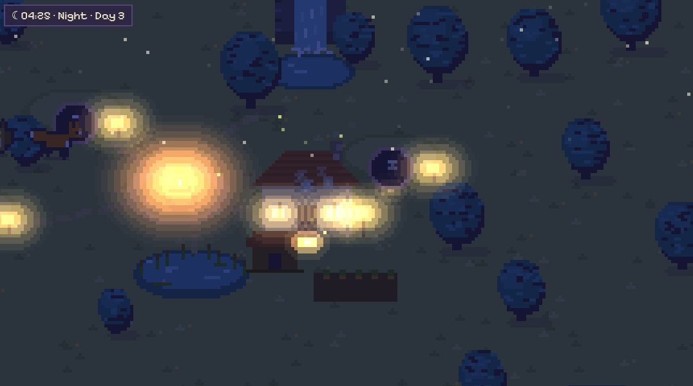
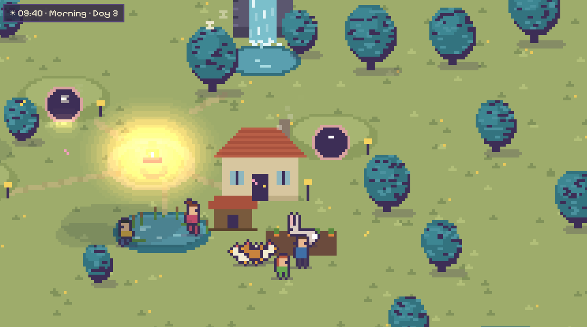

# 🌿 Cozy Animal Village 🐑

**A tiny world full of animals, little adventures, and unexpected moments!**

Welcome to my little pixel-art village, where animals and villagers have their own lives, follow daily routines, explore the world, and sometimes get into funny situations. 🦊🐰

It's a small world that keeps moving even when you're just watching!

## 📸 A little look inside our world
### 🌙 When night falls

### 🌞 The village during the day

## 🌞 What's happening in the village?

- 🐑 Wool the sheep spends time grazing in the meadow.
- 🐰 Clover the rabbit explores the village.
- 🦊 Rusty the fox sometimes tries to sneak into the henhouse!
- 🦉 Hoot the owl comes out at night.
- 👨‍🌾 Tom the farmer takes care of the garden.
- 👨‍👩‍👧‍👦 The family enjoys meals and spends time together.
- 🐕 Biscuit the dog loves chasing other animals.

And that's not all... unexpected things can happen every day!

## 🌈 Explore the little world

- Beautiful day and night transitions.
- Cozy little homes, forests, ponds, waterfalls, and gardens.
- Villagers with their own daily routines.
- Funny animal interactions and surprise events.
- A campfire where everyone gathers.
- Butterflies, fireflies, stars, smoke, and other little details.

## 🎮 Make yourself comfortable

You can:
- Pause and play the village.
- Change the time to morning, noon, evening, or midnight.
- Speed up or slow down time.
- Watch what every villager is currently doing.

Sit back and see what happens!

## 🤖 Made with a little help from AI

This was a fun experiment built with the help of AI tools.

I used AI to explore ideas, bring the world to life, experiment with character behaviours, and turn a simple imagination into a playable little village.

It's a mix of creativity, experimentation, and a lot of fun!

## 🚀 Try it yourself

No complicated installation needed.

1. Clone or download this repository.
2. Open `index.html` in your browser.
3. Welcome to the village!

## 💭 What's next?

The village might get even bigger!

Some ideas for the future:
- 🌧️ Rainy days and changing seasons.
- 🐓 A rooster waking everyone up.
- 💬 Little conversations between villagers.
- 🏡 More houses, animals, and places to explore.
- 🎵 Cozy background sounds and music.
- ✨ More unexpected adventures.

---

**No big mission. No rush. Just a little world with a life of its own. ❤️**

*Thanks for visiting my tiny village!* 🌻
